# Mondpost asset integration

Scoped integration #14, related to acceptance #5. Baseline `856acdf63de20277b8a0bfce72e1153d0c9887c1` contains PR #13's 18 source PNGs but the previous procedural in-game artwork. Source PNGs and their original manifest remain unchanged.

[All 18 original images inspected on navy](source-inspection.png), [prepared runtime previews](runtime-inspection.png), and [per-asset dimensions, pivots, preparation and texture budget](../../assets/sprites/mondpost/README.md). The contact sheets are diagnostic previews of these assets, not original concept images. The two concept originals cannot currently be reopened from local files/downloads; previous visual observations remain in [reference notes](../references/README.md). This integration follows those documented features and the actual supplied source art rather than claiming a fresh pixel comparison with inaccessible concept files.

## Matched views

Pairs show the same flat start after settling/reset, zero distance, paused state and identical viewport. The finish pairs show the unchanged 342m end region. These are actual game screenshots, with the existing HTML footer.

| View | Before | After |
| --- | --- | --- |
| 1280×720 | 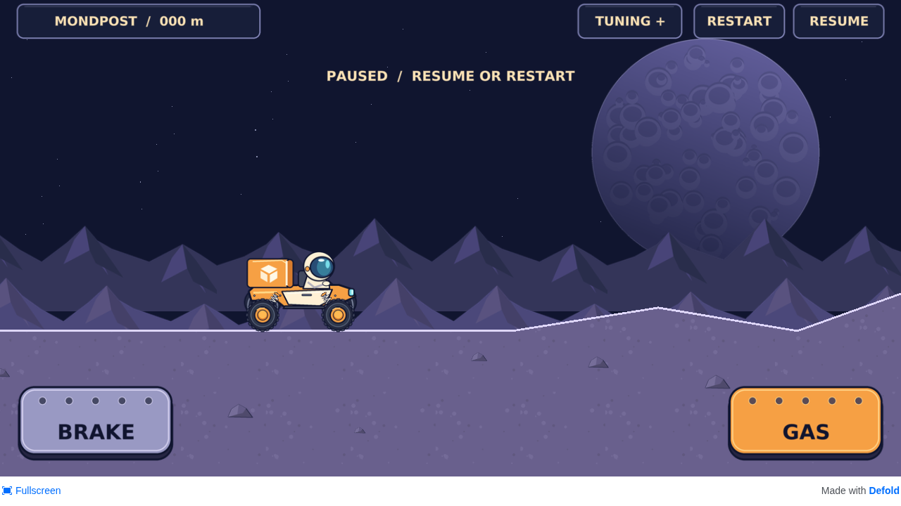 | 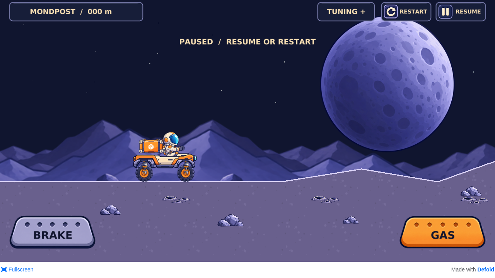 |
| Tablet 1024×768 | 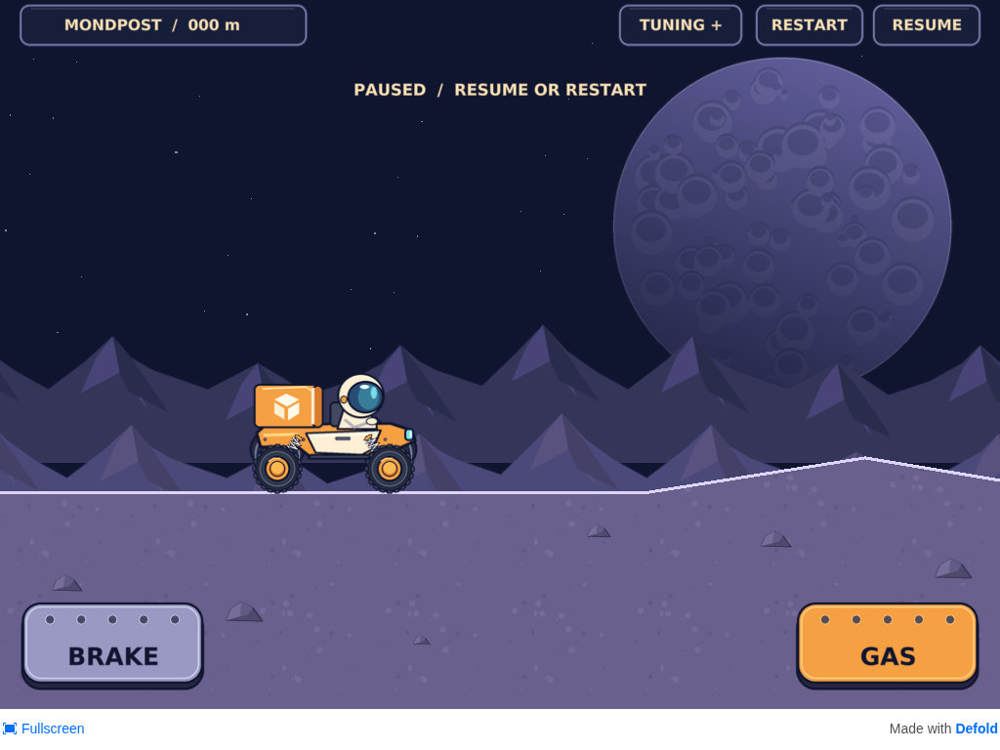 | 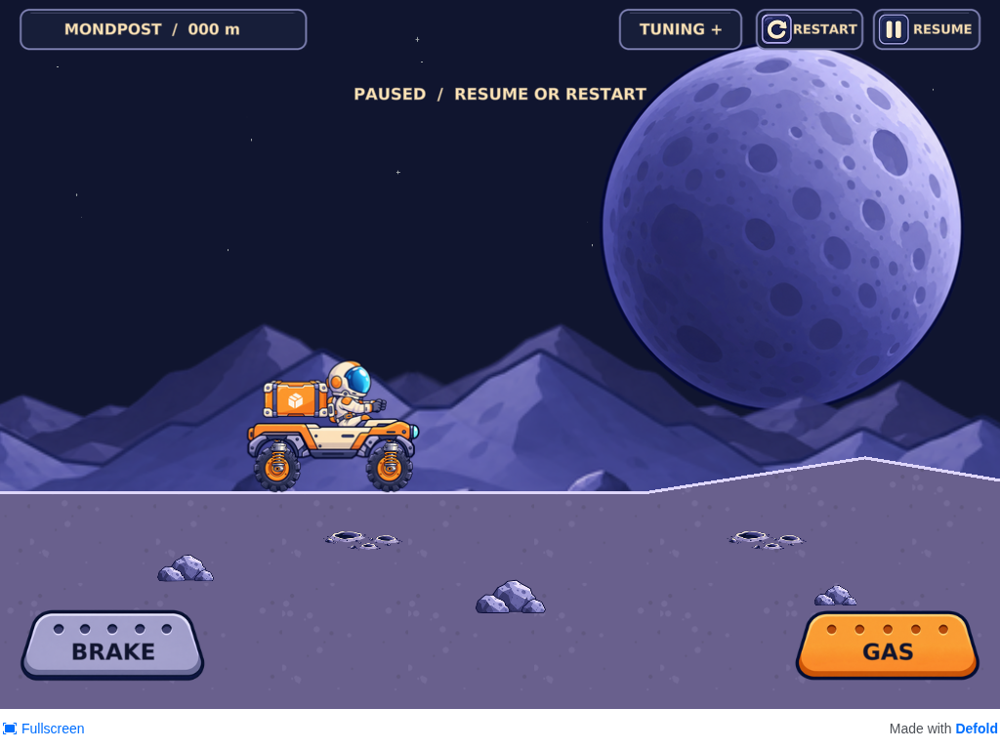 |
| Wide 1920×864 | 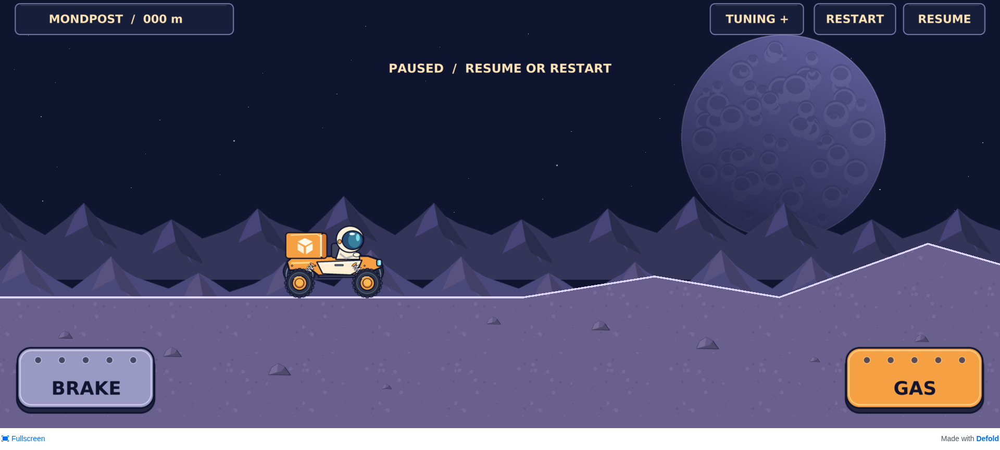 | 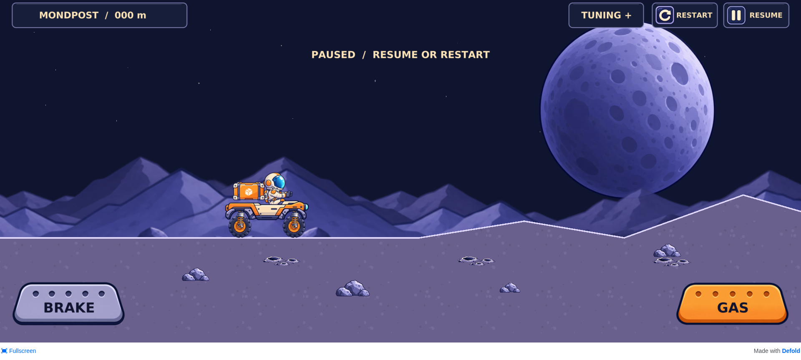 |
| Small wide 960×432 | 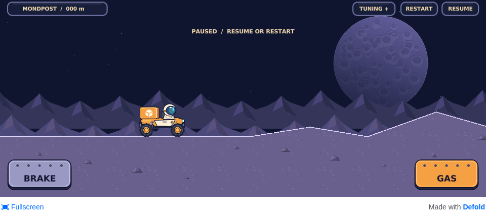 | 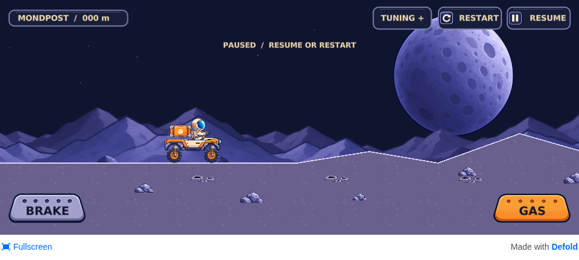 |
| Top tuning |  | 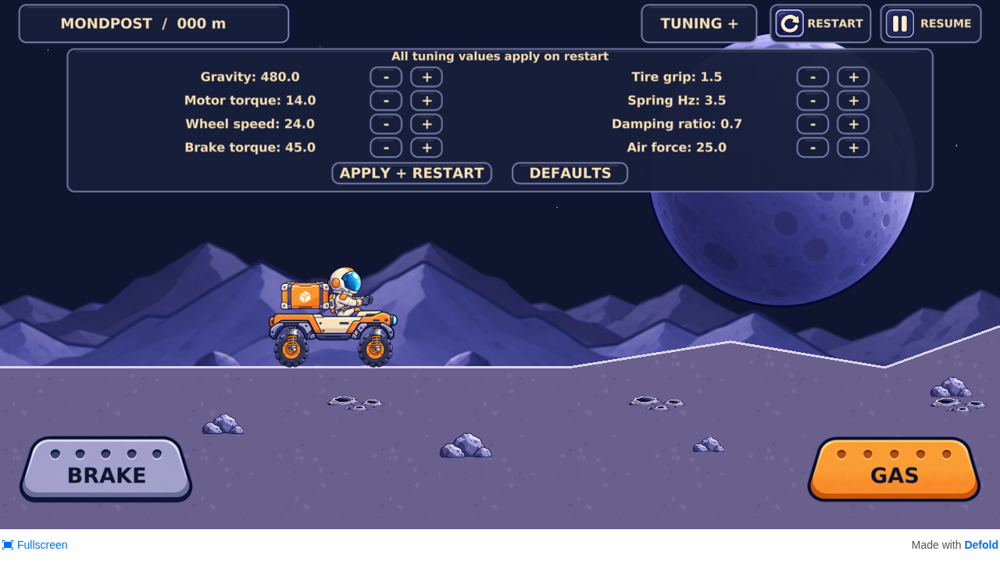 |
| Finish region | 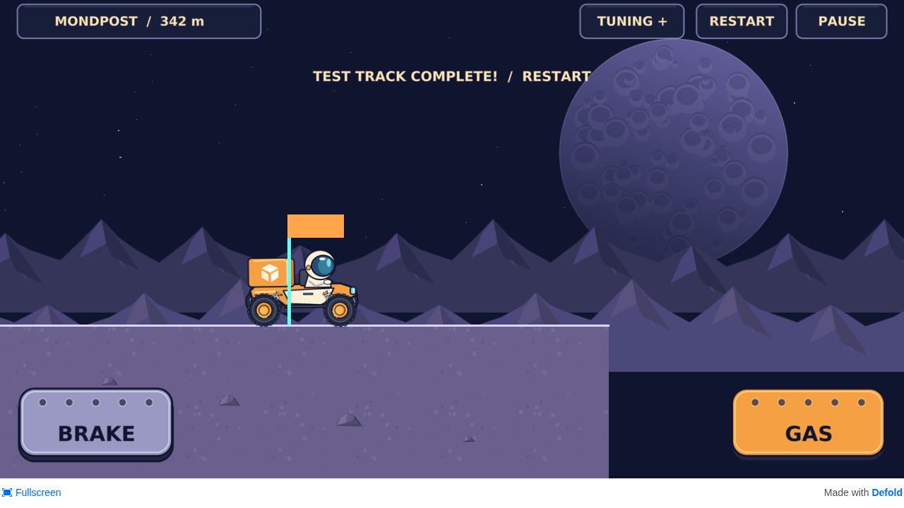 | 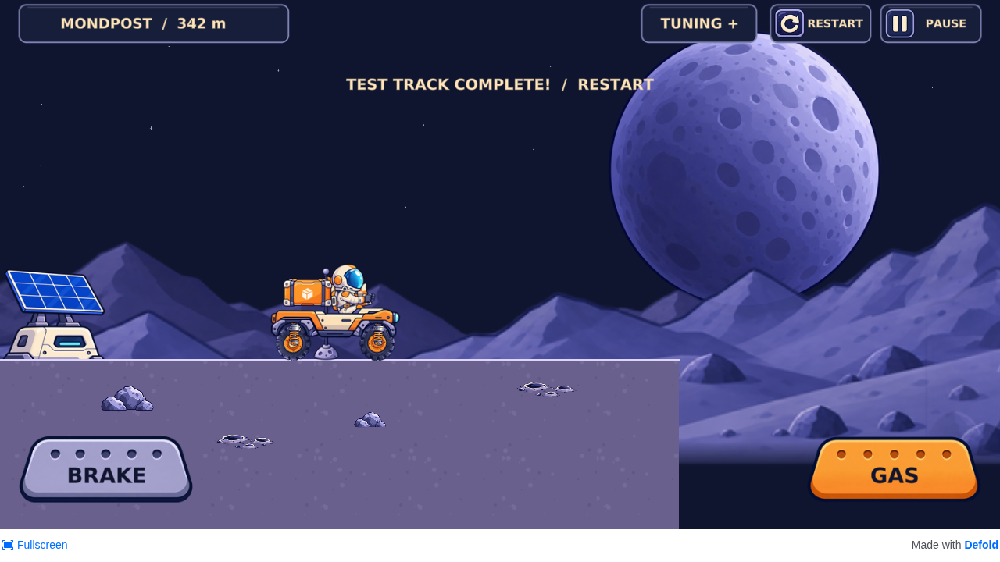 |

## Physical poses and UI

- [Strong compression](after/compression.png), [extension](after/extension.png), [jump](after/jump.png), [touchdown](after/landing.png), [actual frozen telemetry](after/observations.json).
- [Open tuning during a jump](after/tuning-jump.png), [tablet tuning](after/tuning-1024.png), [wide tuning](after/tuning-1920.png), [small-phone tuning](after/tuning-960.png).
- [Gas pressed](after/gas-pressed.png), [brake pressed](after/brake-pressed.png), [moving ground-contact dust](after/driving-dust.png).

Pose captures use independent default-physics drives and wait for acknowledged normal restart/pause/gas input, then freeze for readback. Compression/extension triggers inspect both physical wheel spans. They are observed strong/extreme states, not forced mechanical travel stops; telemetry describes the frozen image, not an earlier live sample. `MOON_CAPTURE_ROOT=docs/asset-integration node tests/visual-review.cjs after` reproduces the sequence after a debug HTML5 build. `--layout-only` refreshes layouts without replacing motion evidence. Optional capture URL/sizes allow the preserved baseline artifact and small viewport to be inspected.

Wheel centers and rotation come from their Box2D bodies. Chassis, driver and parcel are separate sprite components on the existing dynamic body. Cosmetic component offsets accommodate the new canvases; no body, collider, wheelbase, motor, joint, gravity, input arbitration or camera changes were made. The visible upper shock bracket is explicitly offset 38px along the real joint axis because joint rest anchors coincide; its lower eye follows the real wheel center. Chassis/fenders mask compressed tires while coils draw above the wheel face. The actual collision edge and closed ground mesh remain identical; decorative rocks/details are below it. The flag uses its bottom anchor at x=3600; the station has no gameplay function.

## Checks and resolved problems

Passed locally: npm ci, 25 Lua assertions, Renovate schema/native extractor, all original/runtime PNG checks, byte-identical regeneration, final debug HTML5 build and compiled texture validation. The full managed-headless browser suite passed acceleration/braking/both-pedal priority, physical air steering and suspension, 342m completion with jumps/landings, five restarts, pause/resume/focus loss, tuning/reset, independent CDP-emulated two-finger release and an extra touch inside a transparent pedal margin. Tablet, wide and small viewports start without Lua/JavaScript errors. Counters such as air frames/landings are suite telemetry, not device measurements.

Allocated scene sprites: 94, up to 99 during deferred rover replacement; unchanged engine limit 128. Dust pool ceiling: 8, observed peak 4 in the continuous driving check. Compiled atlas/soil payload: 5.328 MiB, ordinary single-page 2D textures, largest 1024×1024, one mip. Font cache, framebuffer, driver and engine memory are excluded. Every build enforces ≤2048 texture dimensions and ≤8 MiB aggregate.

Resolved during inspection:

- Very weak source alpha noise and large canvas margins: explicit alpha/crop rules and premultiplied resampling, with original bytes retained.
- Atlas page-size settings emitted arrays even with one page and caused wrong default-material rendering: use ordinary 2D atlases, with compiled-type checks to prevent recurrence.
- Source spring diagonal/pivot differences and hidden coils: measured eye transform, actual point-driven stretch and reviewed layers.
- Small HUD labels/close icon spacing: minimum readable text, wider top controls and separate rectangular touch areas; compact, relatively placed tuning avoids header/rover overlap.
- Screenshot timing missed short keys/air poses and repeated photo pauses changed later landings: acknowledged held input and independent drives; no assertions weakened or simulation poses assigned.

Final PR/main workflow links and published archive verification are recorded on the PR and #5. Production HTML5/debug Android and all required checks must be green before merge.

## Limits and owner acceptance

This is automated headless-browser keyboard/mouse control plus **emulated** CDP touch and visual inspection of rendered images. No manual native editor session, physical Android/iOS touch, APK installation, real cutout/safe-area or measured mobile FPS is claimed. Browser safe-area insets are zero; existing platform inset handling remains. 60 FPS is a goal. Illustration/physical proportions and the angular test-track silhouette constrain how exactly the older concepts can be matched; driver/cargo remain decorative overhangs, not additional colliders.

Open [the live game](https://bongohorse.github.io/moon/) in landscape. Compare the start and finish; drive GAS/D and BRAKE/A over the hills, watch tire rotation/coils/dust and jump/land. Try both pedals, pause/resume, restart and TUNING on a tablet and a wide phone. The solar station is scenery. Report visual/driving issues in #5, which stays open. No deliveries, batteries, upgrades or next gameplay phase are started.
