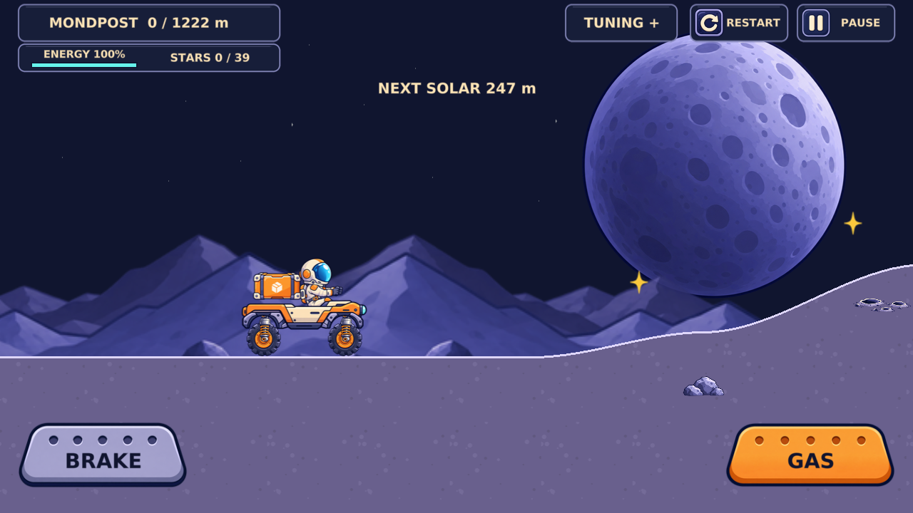
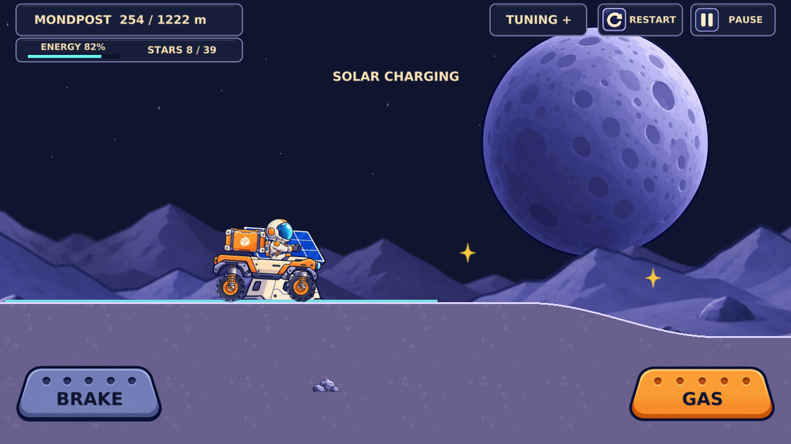
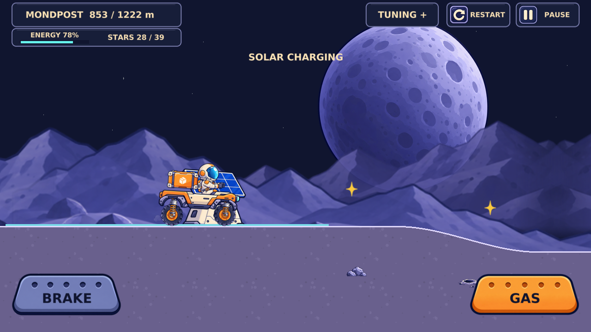
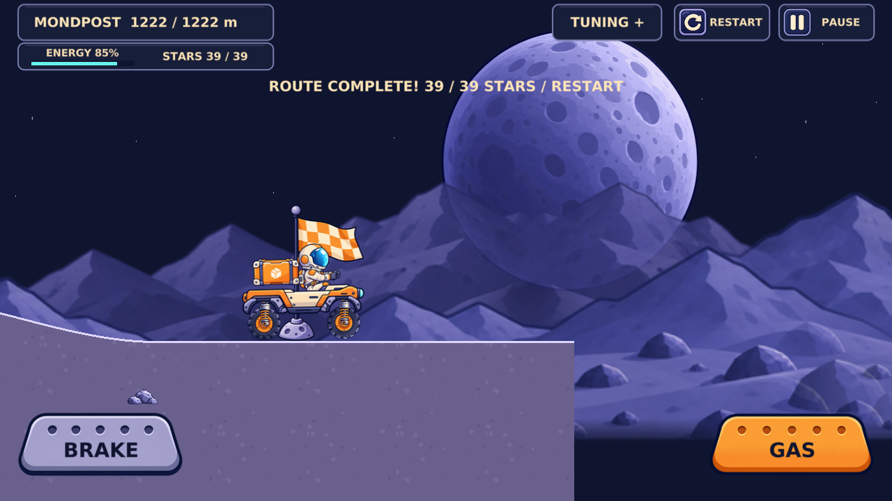
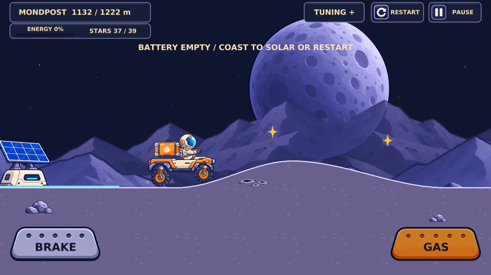
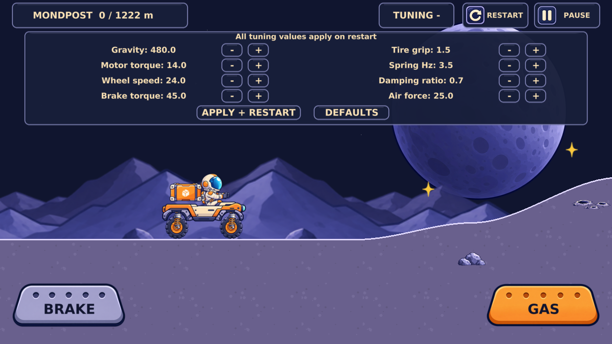
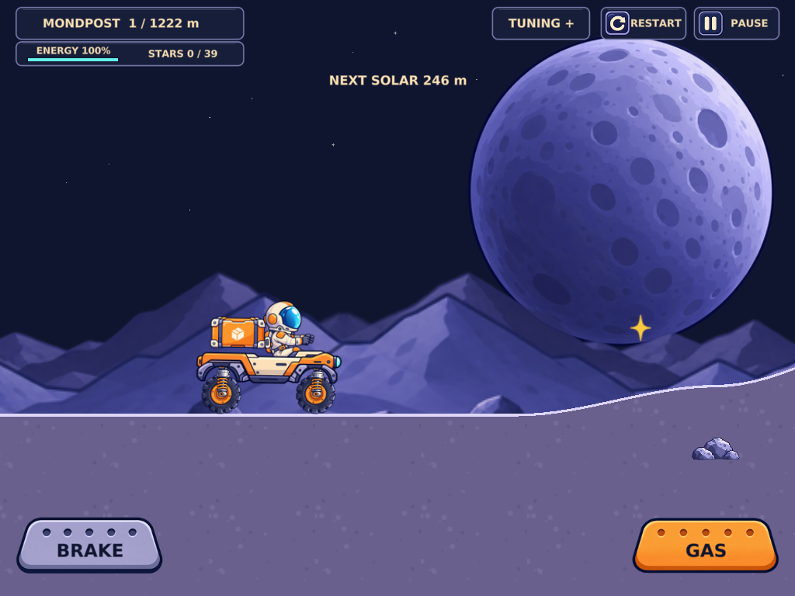
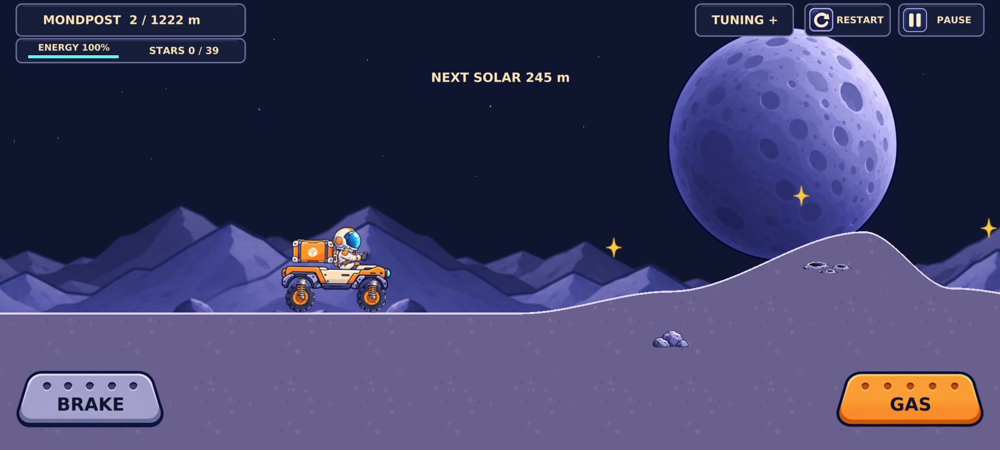
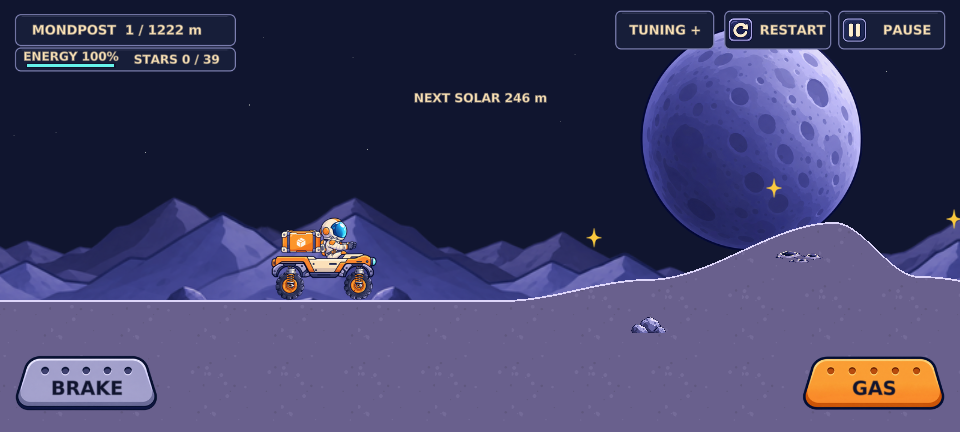
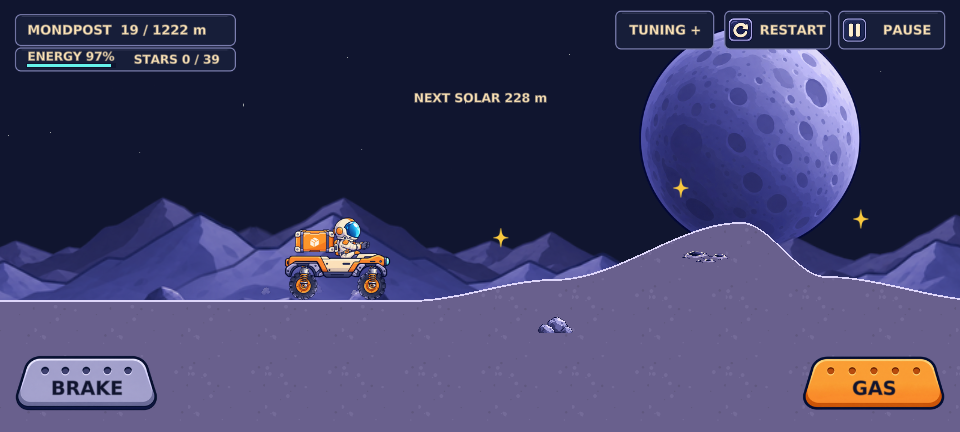

# Rounded route, collectible stars and solar energy

Owner-authorized gameplay scope in #16, following #15's asset integration. Defold 1.14.0 and integrated Box2D 3.1.0 remain pinned. Vehicle masses, shapes, wheel spacing, joints and tuning defaults are unchanged.

## Route design

The previous 342 m angular test course becomes a 1,222 m fixed route with 39 collectible stars and solar platforms at world x=2650, 5550, 8650 and 11000. A flat start leads through rounded hills, a broad ramp, shallow craters and recovery platforms into the final wide landing zone. Stations split the route into four manageable sections; restart begins a fresh run.

`tools/build_level.py` is the route source. Its explicit control knots use cubic smoothstep interpolation, with zero derivative at crests, troughs and platform boundaries. Every solar station has at least 1,000 px of flat recovery/braking terrain; the charge pad spans 700 px so a realistic braking distance fits without forcing a last-moment air brake. Samples are at most 16 design pixels apart, with finer samples where needed to bound adjacent slopes. The first rounded crest has a shorter descent to preserve a real controlled jump. Generated Lua collision samples and soil/rim triangle meshes share identical vertices; the visible surface is the collision top. `python3 tools/build_level.py --check` rejects stale generated files in CI. No concept image is used as terrain.

The sampled static slabs are streamed within 250 px behind and 600 px ahead of the buggy, refreshing every 120 px of travel. The engine still has 128 collision objects and 256 collection instances available. Slabs overlap by 0.8 px to avoid gaps. After a long restart, distant slabs are retired for one fixed step before new allocations because Defold deletion is deferred. Invisible ground sprites were removed; the two closed meshes replace hundreds of rim sprites. Bodies and joints are unchanged. A documented solar braking assist is the sole intentional force change: within 950 px of a station, grounded braking above 5 px/s caps motor torque at `config.docking_brake=6.5`. The original 45-point brake can pitch the short-wheelbase rover onto its roof even on a flat platform; softer deceleration allows a complete charging stop. Normal braking outside station approaches, parking brake at rest and all air control remain unchanged. No body pose is manipulated.

Gold collectible sparkles reuse the bundled asset and are separate from small decorative sky stars. A pool of ten display objects covers supported landscape widths. Logical collection uses a 68 px body-center radius, so the small sprite need not intersect a tire collider. Each star counts once and disappears. Decorations remain below the driving surface.

## Energy rules

`modules/energy.lua` contains bounded independent energy/collection logic:

- Start/restart: 100% battery and zero stars; no persistence.
- Gas: 4 points/second grounded, 2 points/second airborne; brake wins when both pedals are held.
- No idle drain or charge while driving fast; coasting/braking require no energy.
- A solar zone extends 350 px either side of its center, is marked cyan and has a decorative solar tower.
- Charge: 20 points/second only with wheel ground contact, absolute speed at most 70 px/s and gas released or brake held.
- Empty battery disables gas motors and gas air assistance; braking remains physical and available. Coast to a station or restart. No paid rescue, economy or delivery feature.
- Energy changes use the existing 60 Hz fixed update, cap dt at 0.05 s and stop on pause/focus loss/finish. Values clamp to 0–100.

The English HUD shows distance/route length, a readable battery percentage/bar, stars, next station and charging/empty/full feedback. Tuning remains collapsed above the road; resource widgets temporarily hide under the open tuning panel. Pedal touch rectangles, keyboard and two-finger priority are retained. HTML5 footer controls are hidden to dedicate the viewport to the game.

## First launch

The immediate headless cold-launch sample initially drove without reload, but later **parking/sleep** reproduced the problem: controls and battery consumption reported gas while the stopped rover did not move. Box2D 3 joint motor setters do not reliably wake a sleeping island. `vehicle.step` now calls `b2d.body.set_awake(b2d.get_body(...),true)` for chassis and both wheels when effective gas/brake changes. Bodies still sleep while idle; there is no always-awake performance workaround. The API is verified in the [pinned 1.14.0 body bindings](https://github.com/defold/defold/blob/1.14.0/engine/gamesys/src/gamesys/scripts/box2d/v3/script_box2d_body_v3.cpp).

The old suite restarted before driving and never waited for sleep. New cold mouse and isolated mobile-emulated touch cases first **assert a genuinely sleeping body**, then accelerate without reload/restart. The first full solar stop also waits for sleep before driving away. Initial loading-focus transitions no longer pause an unstarted run, and real pointer presses focus the canvas. Once the user interacts, focus loss still pauses/clears input. HTML5 bridges both window blur and focus return into the canvas-only GLFW listeners; returning focus does not resume gameplay automatically. The harness restores native focus after synthetic blur before testing sleep/driving, and uses bounded 90-second section/depletion wall deadlines because the fixed-step hitch cap intentionally discards slow software-rendering time. Physical-device confirmation remains needed.

## Verification and evidence

The complete local acceptance suite passed with no Lua/JavaScript runtime errors. It completed 1,222 m with **39/39 stars**, **four solar stops**, **31 airborne fixed steps**, **two landings** and **84.2% battery remaining** after the final charging stop. The no-charge run separately reached zero battery before the finish, disabled gas motors, retained braking and reset correctly. Mouse and isolated mobile-emulated touch both first waited for actual Box2D sleep, then drove without a reload or initial restart. The parked first solar stop also slept and drove away successfully.

`npm ci`, **1,016 Lua assertions**, Renovate validation/native extraction, source/runtime PNG verification, deterministic route generation and the debug HTML5 build passed. The runner was negatively verified with an intentional failing Lua fixture outside the repository: it returned exit 1. `tools/test_logic.cjs` prevents Fengari's possible error-with-zero-exit from passing CI. Production HTML5/debug Android and green PR/main CI are recorded in the GitHub completion report.

Observed route sample ceilings: **81 steady sprites**, **80 active terrain bodies**, **four visible dust particles** (pool cap eight). The independent deferred-deletion streaming test has a **91-collider peak including rover**; a same-position rover replacement adds at most five temporary sprites, keeping 86 below the existing 128-sprite cap. The compiled seven sprite/terrain textures total **5,587,200 bytes / 5.328 MiB**; largest atlas 1024×1024. Font cache, framebuffers, driver and engine memory are excluded. No mobile FPS claim is made.

The old Lua error exit behavior, sleeping motor island, one-way browser focus bridge and rollover on hard solar braking were found and corrected. Earlier slow software-rendering wall deadlines were diagnosed from a still-moving, awake rover (not bypassed by changing physics): deadlines are bounded at 90 seconds without lowering motion or energy assertions. Vehicle shapes/masses/joints/tuning defaults, source PNGs, dependency lockfile and engine pins remain unchanged. Extreme development tuning can still overturn the rover; no automatic righting or paid recovery is added. Headless Chromium and CDP/mobile emulation are not physical Android/iOS touch, installation, cutout or mobile FPS acceptance. Original downloadable concept files remain unavailable; preserved source assets and previously recorded reference features were used.

## Screenshots

Same flat start, before the route/HUD work (previous asset-integration baseline) and after:

Rounded terrain, active solar charging and goal:

Energy exhaustion with normal driving settings, plus the compact top tuning panel:

Tablet, wide/small landscape and a fresh first touch after sleep:

[Machine-readable browser report](browser-report.json). Images are actual headless browser captures; moving/charging captures are not exact frozen telemetry frames and are not real-device screenshots. The live game retains the supplied Mondpost palette and assembled sprite assets; concept original files cannot be archived from the current workspace.

## Owner test

Open the published game in landscape, wait briefly at the start, then press GAS/D. Watch the rounded first jump and collect gold stars. Before each cyan pad, brake early, release GAS and hold BRAKE until the battery is full. Wait a little longer at the first pad, then drive away to check wake-up. Try both pedals, pause/resume, switching tabs/apps, repeated restart and TUNING on tablet/wide phone. Stars and energy reset on restart. Deliberately skipping all charging stops should exhaust the battery before the goal; brakes remain usable. Report real-device first-launch, touch, safe-area, driving/charging or visual corrections in #5. This scope stops for owner acceptance.
