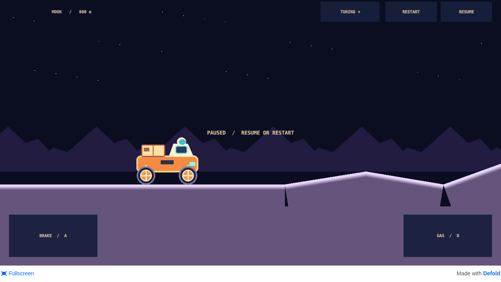
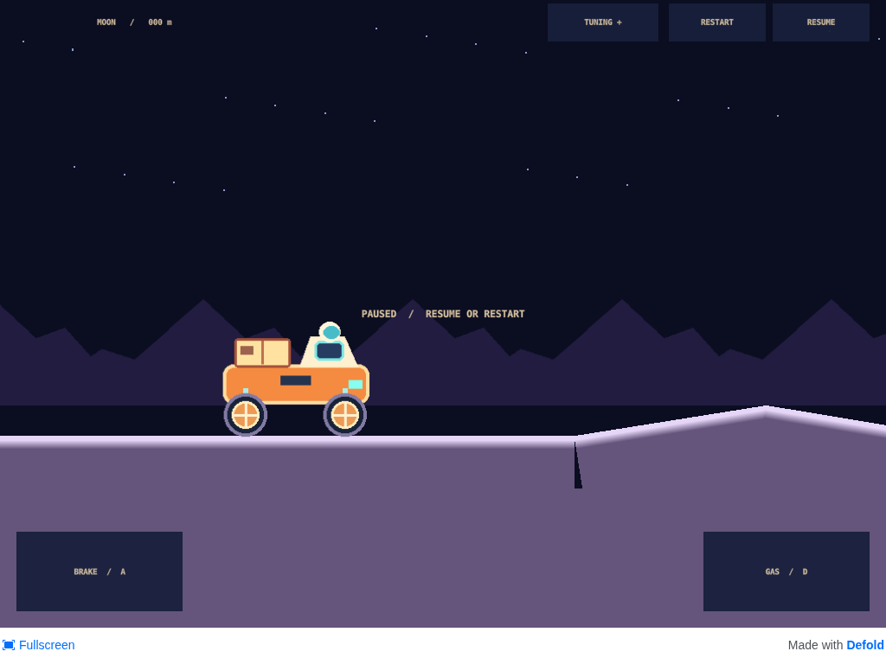
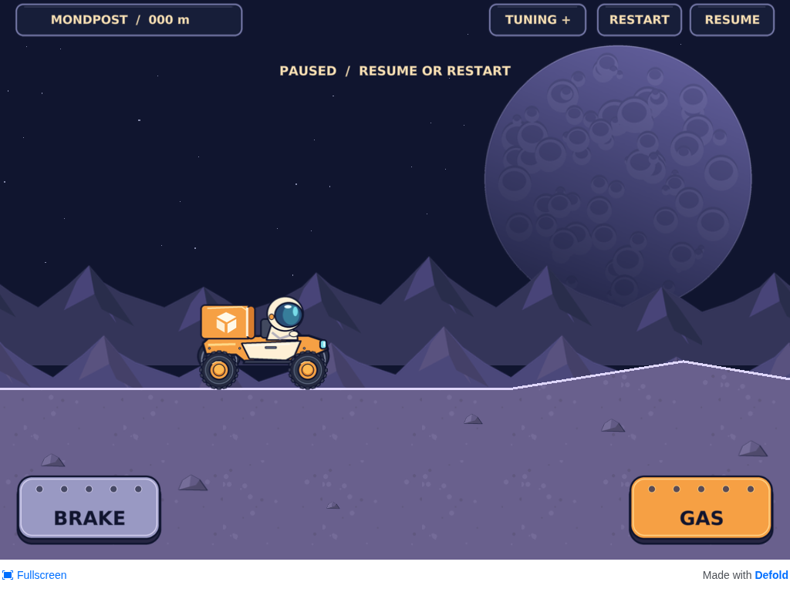
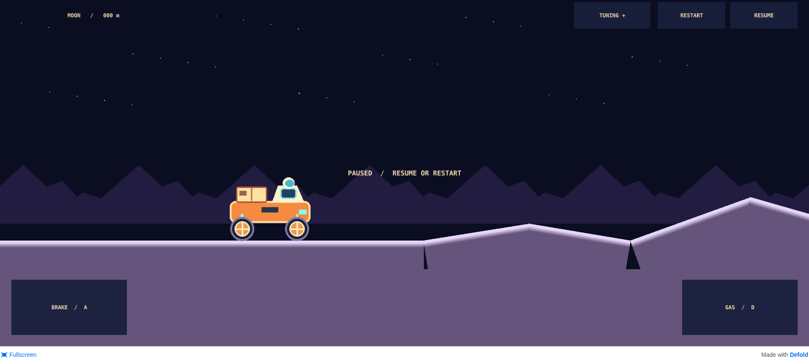
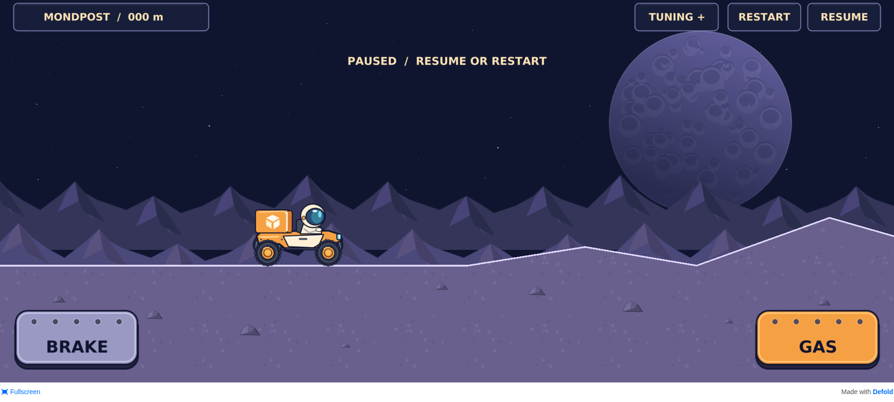
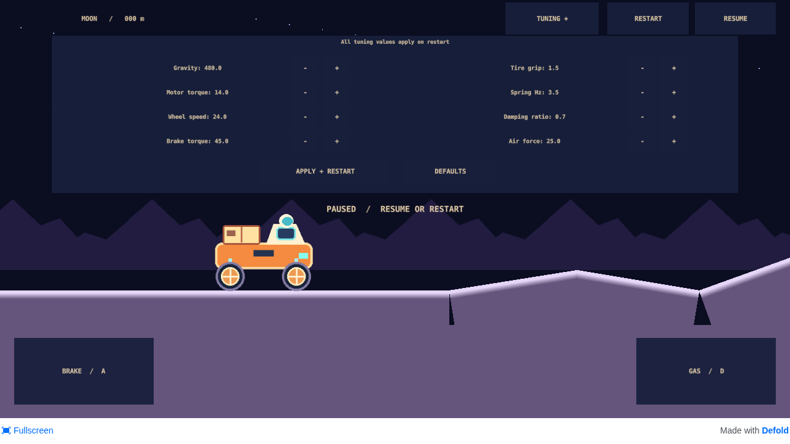
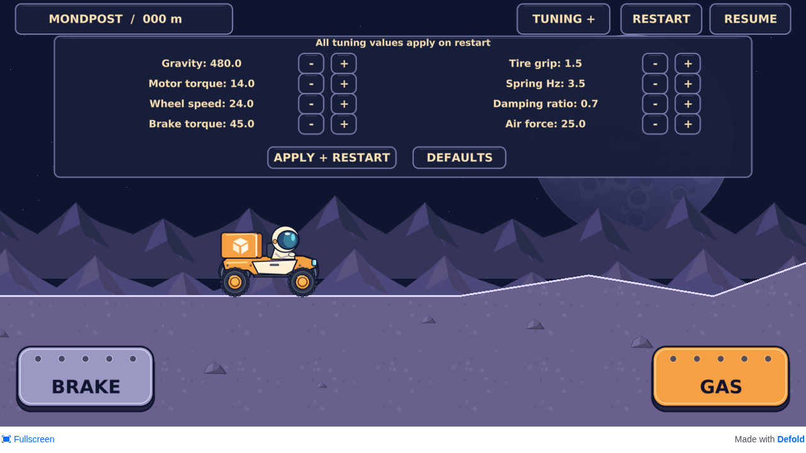

# Phase-one visual correction

Related: acceptance #5 and scoped correction #11. Baseline main: `71df493c18f2f12bae5835b7e84566068b23c0cd`, previously published by run 38431603455. The owner's two references were visually read before artwork changes; original files are unavailable. See [observations and provenance](../references/README.md).

## Same-section comparisons

All paired images use the flat start, zero distance, settled rover, paused state and identical browser viewport. They are actual game screenshots, including the existing Defold HTML footer. Artwork is locally bundled and is never a flattened reference background.

| View | Before | After |
| --- | --- | --- |
| 1280×720 |  |  |
| Tablet 1024×768 |  |  |
| Wide phone 1920×864 |  |  |
| Top tuning |  |  |

## Inspection evidence

- [Compressed suspension](after/compression.png), [extended suspension](after/extension.png), [jump](after/jump.png), [touchdown](after/landing.png).
- [Tablet tuning](after/tuning-1024.png), [wide tuning](after/tuning-1920.png), [pressed brake](after/brake-pressed.png). Gas is visibly darkened in motion captures.
- [Recorded physical telemetry](after/observations.json) identifies observed suspension extrema and capture events. This is the largest observed compression during the captured default-track pass, not a forced mechanical travel limit; no joint stops or physics settings were added.
- `node tests/visual-review.cjs after` reproduces the capture sequence after a local debug HTML5 build. It drives through normal keys only and checks for runtime errors.

The visible wheel centers rotate with their real bodies; tire radius and sprite pivot remain unchanged. Cosmetic diagonal spring endpoints follow chassis-local mounts and actual wheel centers on every render. Closed terrain triangles share the original surface vertices, and overlapping bright edge strokes avoid cracks. Rocks are beneath the driving edge. The ground texture has no baked segment border. The design stays within the original 128-sprite budget, including disabled collision-slab sprites and transient restart bodies.

## Comparison with both references

The gameplay reference's navy sky, large cratered moon, layered violet scenery, left-third orange/cream rover, bright terrain rim and lower tactile pedals are now represented. The detailed sheet's closed cube-marked parcel, helmet visor, dark treaded wheels with orange hubs and separate coils are represented without adding delivery/battery indicators. UI stays in the existing English language; its font and panel outlines are consistent.

Remaining differences: this is a simpler original illustrated style, not the references' painted rock detail, lighting or organic terrain silhouette. Rover proportions remain constrained by the existing 180×110 sprite footprint and 24px physical tire radius; they were not enlarged at the cost of collider alignment. Terrain slopes and camera are unchanged. No decorative solar station was added. The reference's center HUD examples are adapted to preserve the existing input layout and track visibility.

## Validation limits and owner test

Screenshots are visually inspected headless-browser output, with desktop keyboard and emulated touch tested separately in the functional suite. Browser safe-area insets are zero; code still places controls inside platform-reported insets. Nonzero Android/iOS cutouts, native touch, APK installation and measured device FPS require real hardware. No physical device is attached.

Open the [published prototype](https://bongohorse.github.io/moon/) in landscape. Compare the start with the images above; drive with GAS/D and BRAKE/A. Watch the springs over the first hills, try both pedals, pause/resume and restart. Open TUNING while watching the rover and road; test tablet and wide-phone screens. Report visual or driving issues in #5. That issue stays open for owner acceptance; no subsequent gameplay phase is started.
